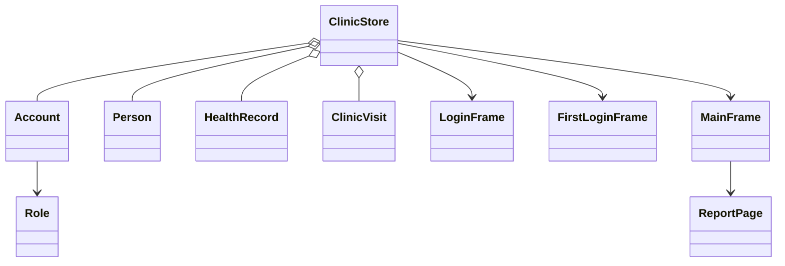

# CCC Pulse App

**Automated School Clinic Physical Assessment System** is a Java Swing desktop prototype for the school clinic. It models the student clearance process and tracks clinic visits for students and faculty.

## Problem statement

Students need current nurse-reviewed physical assessments before school activities that require medical clearance. The app keeps assessment and visit histories together, records the nurse's fitness decision and remarks, tracks the six-month validity period, and reminds students when another assessment is due.

## Features

- Student and nurse sign-in with separate navigation and demo accounts.
- First-login password change for the demo student; editable student profile and password settings.
- Show/hide password controls on sign-in and password settings.
- Nurse-managed physical assessments for height, weight, blood pressure, oxygen, blood type, history, allergies, concerns, clearance decision, remarks, and enrollment medical-certificate copy status.
- Sectioned, form-style assessment entry with required last and first names, optional middle name and suffix, course/year selections, Yes/No medical-history and allergy questions with conditional descriptions, and single-choice nurse fitness decisions.
- Dedicated add-student profile page with the same name fields, course/year dropdowns, contact details, validation, and first-login account credentials.
- Six-month assessment validity and dashboard reminders for missing or expired assessments.
- Student history and clinic visit tracking, including nurse remarks and treatment provided.
- Nurse student directory, assessment entry, all-visit history, and faculty/non-student visit records without personal accounts.
- Account menu with profile, password-change, and sign-out actions.
- Designed, separate report page with the CCC logo, assessment and visit details, printing, and text-file export.
- Required-field and numeric range validation.

## Demo sign-in

| Role | Username | Initial password |
| --- | --- | --- |
| Student | `25-00001` | `pulse123` (must change at first sign-in) |
| Nurse | `nurse` | `nurse123` |

This is sample data for a classroom demonstration. All data is held in memory and is cleared when the application closes. Do not enter real health information.

## Run

Requires a JDK. From this folder, run `run.bat`, or use:

```sh
javac -encoding UTF-8 -d build src/cccpulse/CccPulseApp.java
java -cp build cccpulse.CccPulseApp
```

## OOP design

- `Account` encapsulates credentials, role, and first-login password-change state.
- `Person` represents student and faculty profile information.
- `HealthRecord` captures a dated assessment and computes its six-month expiry.
- `ClinicVisit` records a visit and allows a nurse to update remarks and treatment.
- `LoginFrame`, `FirstLoginFrame`, and `MainFrame` provide sign-in, first-login setup, and role-based Swing views.



Students and faculty share the `Person` profile model; the `Role` enum distinguishes student and nurse accounts.

## Scope and limitations

- This is a single-machine prototype. There is no database, network service, durable storage, real authentication security, automated appointment scheduling, or actual electronic notification. Expiry reminders appear when a student signs in and checks the dashboard.
- The medical-certificate field records whether a copy was received; it does not scan or store the certificate itself.
- Faculty visit records are kept separately and do not require faculty accounts.
- The report export is plain text. Printing uses the operating system's configured print service.

## Demo walkthrough

1. Sign in as `25-00001` / `pulse123`, review or edit the profile, set a new password, and browse the dashboard, assessment, history, medical records, clinic visits, and settings.
2. Sign out, then sign in as `nurse` / `nurse123`.
3. Select a student in **Students**, record an assessment, and review the six-month status and certificate-copy indicator.
4. Open **History** and double-click a visit to update nurse remarks and treatment. Use **Non-students** to create a faculty visit.
5. Try an empty visit reason or non-numeric height/weight to see validation feedback.

## Sample validation cases

| Scenario | Expected result |
| --- | --- |
| Unknown username or incorrect password | Sign-in is rejected with a clear message |
| First student sign-in | Requires a new password of at least six characters |
| Empty profile name or contact | Profile is not saved |
| Nonnumeric height/weight | Assessment is not saved |
| Height below 80 cm, above 250 cm, weight below 20 kg, or above 350 kg | Assessment is rejected |
| Empty faculty/student visit reason | Visit is not saved |
| Assessment older than six months | Clearance is marked expired and shown as due |

